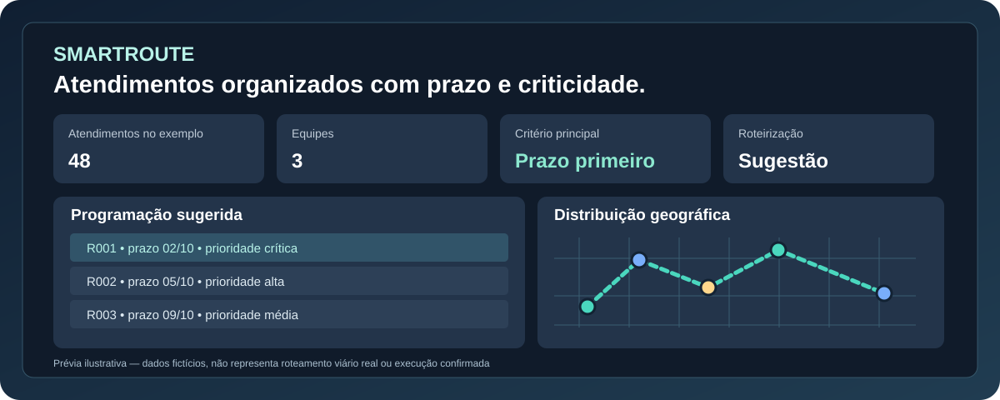

# SmartRoute · Roteirização e Programação

**Ferramenta demonstrativa de planejamento de atendimentos, com critérios de prazo, criticidade, equipe e localização.**  
Desenvolvido por **Talita Souza** · Engenharia de Controle e Automação · PCM, dados e automação

**[Abrir a demonstração online ↗](https://talita-olv.github.io/smart-route/)**

[](tests/) [](assets/core.mjs) [](docs/REGRAS.md) [](LICENSE.md)



> **Atenção:** projeto demonstrativo independente, com **48 atendimentos inteiramente fictícios**. As distâncias estimadas são em linha reta e a sequência é heurística: **não** representa navegação por vias, tempo de deslocamento, cumprimento automático de SLA ou confirmação de execução. Verifique a programação antes de utilizá-la.

## O problema

Distribuir atendimentos somente pela proximidade pode antecipar demandas menos urgentes enquanto outras ultrapassam seus prazos. Além disso, organizar manualmente equipes, unidades e prioridades exige conferências repetitivas.

O SmartRoute demonstra como organizar a programação **priorizando o vencimento antes da geografia**, sem perder de vista a capacidade e a região dos atendimentos.

## O que a demonstração permite

- Explorar **48 atendimentos fictícios**, distribuídos em 12 grupos locais e 3 equipes.
- Importar **CSV ou Excel (.xlsx/.xls)**, até 120 registros por arquivo na demonstração pública.
- Filtrar por segmento, região, tipo de serviço, equipe, situação e prioridade.
- Planejar por **data limite, criticidade e proximidade**, nessa ordem, por equipe; identificar propostas após o prazo.
- Manter `grupo_local` junto quando couber na capacidade, ou dividir grupos maiores com aviso.
- Ajustar ponto de partida, data inicial e até **12 paradas por rota**.
- Apresentar pontos e sequência aproximada no mapa de ruas, com tentativa de novo carregamento se o serviço externo falhar.
- Exportar CSV revisável com data, equipe, sequência, informações da ordem e `situacao_prazo`.
- Executar testes automatizados da lógica e dos fluxos de interface.

## Como utilizar

1. **[Abra o SmartRoute](https://talita-olv.github.io/smart-route/)** e clique em **Recarregar exemplo** ou baixe o [modelo Excel](exemplos/Modelo_SmartRoute.xlsx) / [CSV](exemplos/Modelo_SmartRoute.csv).
2. Se importar uma planilha, confira os campos obrigatórios: `id`, `latitude`, `longitude`. Os demais campos refinam a programação ou são informativos.
3. Selecione filtros, data inicial, limite de paradas e ponto de partida.
4. Clique em **Gerar programação**. Veja as datas e os avisos de atraso — inclusive quando o grupo mais urgente não couber no dia.
5. Revise os trajetos estimados, as condições operacionais e a capacidade real de trabalho; só então exporte a programação em CSV.

Para uso local, sirva os arquivos por HTTP (não basta abrir módulos ES por `file://`). Exemplo: `npx serve .` ou outro servidor estático. O projeto também pode ser apresentado em HTML independente com `node scripts/build_standalone.mjs`.

## Tecnologias e organização

| Tecnologia / arquivo | Aplicação |
| --- | --- |
| HTML, CSS e JavaScript ES Modules | Interface, filtros, regras e exportação |
| `assets/core.mjs` | Validação, prazo, agrupamento, heurística e CSV |
| `assets/app.mjs` e `assets/demo.mjs` | Interface e exemplos fictícios |
| Leaflet e OpenStreetMap | Mapa de ruas; **não** fornece roteamento por vias |
| SheetJS (sob demanda) | Leitura de planilhas Excel; alternativa CSV |
| GitHub Pages | Demonstração estática |
| `tests/` e `scripts/check_browser.cjs` | Regressão e testes visuais desktop/mobile |

O CSV e a lógica de programação não dependem da disponibilidade do mapa. Bibliotecas e mapas de terceiros podem fazer requisições pela rede; consulte [avisos de terceiros](THIRD_PARTY_NOTICES.md).

## Critérios de planejamento e limites

A decisão é **data limite mais próxima → criticidade → distância em linha reta**. O desempate só ocorre entre demandas do mesmo grupo de prioridade temporal. Grupos da mesma unidade permanecem juntos quando a capacidade permite. Em situações de conflito, o sistema **avisa** sobre ordens previstas após o vencimento; não promete que todas as demandas caberão no horizonte.

- Datas de prazo: `AAAA-MM-DD` ou `DD/MM/AAAA` na importação. Datas inexistentes geram aviso; atendimentos sem prazo válido são tratados depois dos datados.
- Programação usa dias úteis de segunda a sexta, **sem calendário de feriados**.
- A duração do serviço informa estimativas de carga, mas não é usada como restrição de turnos.
- Horários e janelas, tráfego, especialidades, indisponibilidade da equipe e distâncias viárias não são calculados nesta demonstração.
- Não há importação de dados corporativos, extração automática de ERP/CRM, backend, autenticação ou coleta de métricas própria.

**Personalização sob medida:** a integração com ERP, CRM, sistema de chamados ou scripts de extração específicos requer autorização, análise técnica e um escopo separado. Veja [Integração personalizada](docs/INTEGRACAO_PERSONALIZADA.md) e [regras do algoritmo](docs/REGRAS.md).

## Testes e contribuição

```bash
node --test tests/*.test.mjs
node scripts/build_standalone.mjs
```

O workflow **Verify SmartRoute** também cobre, em navegador, filtros, importação, geração, exportação e layout desktop/mobile. Consulte a [validação](docs/VALIDACAO.md) e o [histórico de versões](CHANGELOG.md).

**Processo obrigatório:** [Issue](https://github.com/talita-olv/smart-route/issues) → branch → testes → [Pull Request](https://github.com/talita-olv/smart-route/pulls) vinculado à Issue → revisão → merge na `main` → GitHub Pages. Instruções completas: [AGENTS.md](AGENTS.md) e [CONTRIBUTING.md](CONTRIBUTING.md). Não executar mudanças diretas em produção.

## Privacidade, licença e autoria

Nenhuma base operacional ou credencial acompanha esta demonstração. Os dados importados são processados no navegador, mas serviços externos de mapa e bibliotecas podem receber requisições normais de acesso. **Não utilize dados confidenciais em ambiente público sem avaliação e autorização da organização.**

**© 2026 Talita Souza. Todos os direitos reservados.** Diferentemente de projetos licenciados sob MIT, o SmartRoute tem **[termos de uso restrito](LICENSE.md)**: cópia, modificação, redistribuição e uso comercial dos materiais próprios dependem de autorização prévia e por escrito, respeitando permissões legais e de terceiros. Tornar o repositório público não concede licença permissiva.

---

**Identidade visual:** [marca Talita Souza](assets/talita-brand.svg) · [banner do SmartRoute](assets/project-banner.svg) · [template de README](https://github.com/talita-olv/talita-olv/blob/main/README_TEMPLATE.md)

Desenvolvido por **[Talita Souza](https://github.com/talita-olv)** · [LinkedIn](https://www.linkedin.com/in/talita-souza-136590122/)
